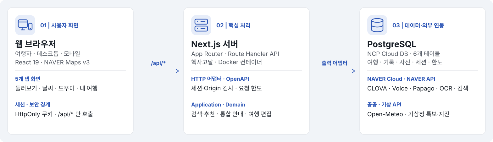

# 경기 하루이음

## 소개

경기도 31개 시·군 관광지 탐색, AI 추천, 패스 구성, 방문 기록을 제공하는 Next.js MVP다([요구사항](docs/01-func/01-requirements.md)).


### 주요 화면

[데스크톱 탐색](docs/screenshots/desktop.jpg) · [모바일 여행](docs/screenshots/mobile.jpg) · [데스크톱 도우미](docs/screenshots/assistant-desktop.jpg) · [모바일 도우미](docs/screenshots/assistant-mobile.jpg) · [사진 일기](docs/screenshots/photo-record.jpg).

## 기술 스택

Next.js 16 · React 19 · TypeScript · Zod · Scalar(OpenAPI 3.1) · Sharp · PostgreSQL(`pg`) · NAVER Cloud(CLOVA Studio·Voice·Papago·OCR·Maps·Cloud DB). 버전은 [package.json](package.json)에서 관리한다.



## 시작하기

Node.js 24+와 PostgreSQL 16+가 필요하다.

```sh
npm ci && cp .env.example .env.local
# .env.local에 DATABASE_URL을 설정한다.
npm run dev
```

[http://localhost:3000](http://localhost:3000)으로 접속한다(주소 변경 시 `APP_ORIGIN` 동기화). 테이블은 첫 DB 요청 시 자동 생성되며 키 설정·배포는 [배포 가이드](docs/05-ops/01-deploy.md)를 따른다.

- **데이터 갱신**: `TOUR_API_KEY` 설정 후 `npm run data:tourapi`로 관광지를 수집하고([기준](docs/01-func/01-requirements.md#시군별-관광-데이터-확장)), `npm run data:label`로 라벨을 갱신한다(`--bootstrap`, `--limit=20` 지원).

## 사용 방법

| 탭 | 주요 기능 |
| --- | --- |
| 경기 둘러보기 | AI 검색·추천과 시·군 지도로 장소를 담아 여행을 저장한다. |
| 경기 날씨 | 경기도 전체·31개 시·군의 현재 날씨·옷차림·5일 예보와 추천 장소를 확인한다. |
| 여행 도우미 | 선택 시·군의 안전 안내·통합 안내 원고·음성·옷차림·추천 명소·맛집을 확인한다. |
| 내 여행 | 코스 지도, 방문 기록·사진·일기, 대화형 여행 수정·번역을 이용한다. |
| 프로필 | 네이버 로그인·로그아웃, 여행 요약, 브라우저 여행 취향을 관리한다. |

API 문서는 `/api/docs`(OpenAPI JSON: `/api/openapi`, [계약](docs/03-tech/01-architecture.md#http-api-계약)), 운영 상태는 [모니터링 가이드](docs/05-ops/01-deploy.md#운영-모니터링)에서 확인한다.

## 테스트

검증 전략과 최신 결과는 [테스트 명세](docs/04-test/01-verification.md)에서 관리한다.

```sh
npm run format:check && npm test && npm run typecheck && npm run build
python3 .github/scripts/check_docs.py
```

- 서식 수정은 `npm run format`, 단위 검사는 `DATABASE_URL`(또는 `TEST_DATABASE_URL`)의 임시 스키마를 사용한다.
- HTTP 검사는 AI 키 없는 서버(`PORT=3100`)에서 `tests/http.mjs`·`tests/extensions-http.mjs`, 더미 로그인 키 서버에서 `tests/auth-http.mjs`, DB 없이 `TEST_BASE_URL` 지정 후 `tests/city-weather-http.mjs`(`EXPECT_LIVE_WEATHER=true`는 실시간)를 실행한다.

## 관련 문서

- [작업 지침](AGENTS.md) · [관광 데이터](data/places.json) · [경기도 지도 작업 계획](docs/gyeonggi-city-map-plan.md) · [평가 항목 안내](docs/evaluation.md) · [제출용 기술 문서](docs/technical-report.md) ([PDF](docs/technical-report.pdf))

### 문서 분류 기준

<!-- doc-standard:start — doc-standard에서 동기화한다. 이 구간은 직접 고치지 않는다. -->
| 위치 | 담는 내용 |
| --- | --- |
| [`docs/01-func/`](docs/01-func/01-requirements.md) | 범위, 역할별 기능, 업무 정책, 완료 기준 |
| [`docs/02-uxui/`](docs/02-uxui/01-design.md) | 화면 배치·조작·디자인 기준·시각 자산 |
| [`docs/03-tech/`](docs/03-tech/01-architecture.md) | 아키텍처, 소스 구조, 데이터 모델, REST/IPC 계약 |
| [`docs/04-test/`](docs/04-test/01-verification.md) | 검증 방법, 판정 기준, 최신 판정과 증거 |
| [`docs/05-ops/`](docs/05-ops/01-deploy.md) | 배포·인프라 구성·운영 점검·장애 대응 |
| `docs/` 루트·주제 폴더 | 비명세 자료(과제 안내, 보고서, 발표, 협업 규칙, 자료 수집 기록) |
| 코드 저장소 루트 README | 로컬 설치·실행·테스트 명령 |

API 상세 원본은 OpenAPI·라우터·DTO이며 명세에는 원본 위치와 한계만 적는다. 배포 절차는 `05-ops/`(없으면 기술 명세)에 두고 로컬 실행 명령은 README를 링크한다.
<!-- doc-standard:end -->
