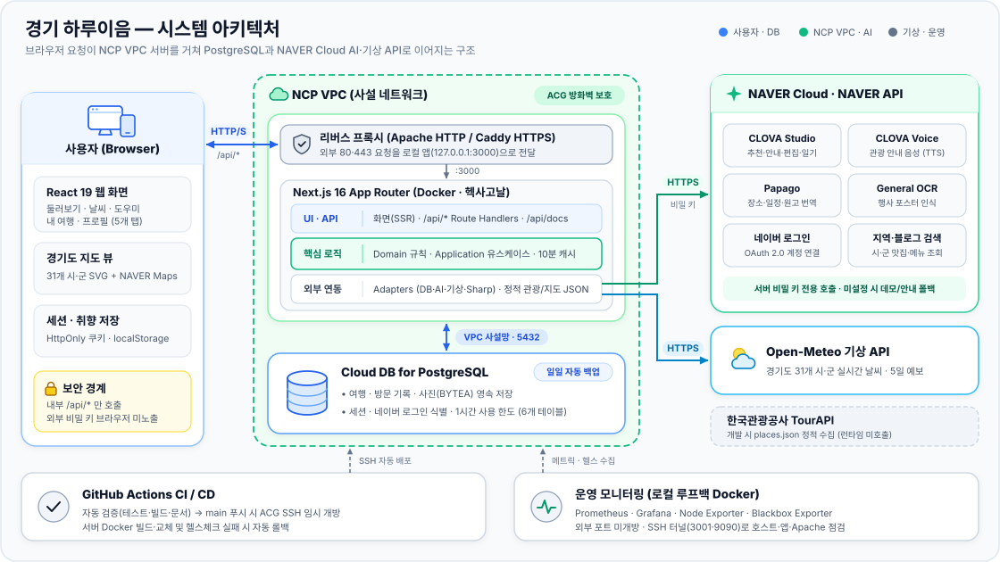

# 기술 구조 — 경기 하루이음

[문서 안내](../../README.md#문서-분류-기준)

## 아키텍처와 경계

Next.js App Router(Node.js)가 화면과 Route Handler API를 제공하고 영속 데이터는 외부 PostgreSQL(운영: NCP Cloud DB)에 저장한다([기술 스택](../../README.md#기술-스택), [요구사항](../01-func/01-requirements.md)).

헥사고날 아키텍처로 도메인이 모델·규칙을 소유하고 애플리케이션이 포트로 저장소·외부 API를 호출한다. 안쪽 계층은 프레임워크·DB·환경 변수·네트워크에 비의존하며 브라우저는 `/api/*`만 호출하고 비밀 키는 서버에만 둔다.

## 소스 구조

| 경로 | 책임 |
| --- | --- |
| [app/](../../app/) · [components/](../../components/) | 화면, Route Handler, 탭 공유 상태(`Tourpass`)를 제공한다. |
| [lib/domain/](../../lib/domain/) | 카탈로그·Zod 계약·검색/날씨/옷차림/원고/맛집/특보 규칙을 소유한다. |
| [lib/application/](../../lib/application/) | 유스케이스, 외부 포트, 공용 TTL·LRU·병합 캐시([cache.ts](../../lib/application/cache.ts))를 제공한다. |
| [lib/adapters/](../../lib/adapters/) | PostgreSQL·NAVER·Open-Meteo·기상청·이미지·HTTP·브라우저 어댑터를 구현한다. |
| [lib/server.ts](../../lib/server.ts) | 어댑터 주입과 `globalThis` 싱글톤 고정으로 청크·HMR 간 캐시를 공유한다. |
| [data/](../../data/) · [public/places/](../../public/places/) | 정적 관광·지도·라벨 데이터와 사진을 보관한다. |
| [deploy/](../../deploy/) · [.github/workflows/](../../.github/workflows/) | 배포·모니터링·CI/CD를 구성한다. |
| [tests/](../../tests/) | 경계·단위·모의 연동·HTTP 검사를 제공한다. |

## 경기도 지역 선택 지도

[build_gyeonggi_map.py](../../scripts/build_gyeonggi_map.py)가 SGIS 기반 [vuski/admdongkor(2026-10-01)](https://github.com/vuski/admdongkor/tree/3bc00489b76696db864bdbea4b19985cdfa8b403/ver20261001) SHA-256을 검증해 [gyeonggi-map.json](../../data/gyeonggi-map.json)과 [라이선스](../../data/gyeonggi-map.LICENSE.txt)를 생성한다. `Tourpass`의 `selectedCityId`를 지도·날씨·도우미가 공유하며 시흥 권역 필터(`region`)와 분리한다([요구사항](../01-func/01-requirements.md#경기도-지역-선택-지도)).

## 외부 연동과 캐시

캐시 히트 시 요청 한도를 차감하지 않는다.

| 영역 | 핵심 동작과 캐시 |
| --- | --- |
| 날씨·옷차림 | `WEATHER_REGIONS` 좌표를 공유해 `/api/weather`·`/api/weather/current` 성공 응답을 도시별 10분 캐시·병합한다(데모 미캐시, [정책](../01-func/01-requirements.md#탐색추천날씨)). |
| 네이버 지도 | `NAVER_MAP_CLIENT_ID`를 런타임 주입해 v3 SDK를 1회 로드하고 미설정·인증 실패 시 경기도 SVG로 폴백한다. |
| 관광 데이터·라벨 | `scripts/import-tourapi.ts`(공공누리 1유형 사진만 허용)와 `scripts/label-places.ts`(CLOVA 배치)로 갱신하며 `data/place-label-overrides.json` 수동 보정을 우선 병합한다. |
| AI 검색·추천 | 클라이언트·서버가 같은 조건 필터를 쓴다. 1차 후보(20곳) → Reranker → `HCX-005` Function calling(`recommend_itinerary`) 검증 후, 만족도 없는 동일 조건을 10분·200건 캐시·병합한다. |
| 통합 안내·번역·음성 | 날씨·맛집 → 원고 앞부분(HCX·검증) + 명소·맛집 뒷부분(코드) → Papago → Voice 순으로 처리한다. 통합 안내(10분), 정적 장소 번역(24시간·500건)·음성(24시간·100건)을 캐시·병합하고 UI는 350ms 디바운스·`AbortController`를 적용한다. |
| 맛집·안전 안내 | NAVER 지역·블로그 검색(술집·타 지역 제외, 후기 검증)과 기상청 `getPwnStatus`·`getEqkMsg` 전국 자료를 각 10분 캐시·병합한다. |

## HTTP API 계약

상세 경로·스키마는 [openapi.ts](../../lib/adapters/openapi.ts), [contracts.ts](../../lib/domain/contracts.ts), [assistant.ts](../../lib/domain/assistant.ts)가 원본이며 `/api/docs`로 조회한다.

- `http.ts`가 세션·`Origin` 검사·JSON 본문 상한·도메인 오류 상태 변환을 처리한다.
- `images.ts`는 2MB·픽셀·형식을 검증해 JPEG 재인코딩하고, `naver.ts`는 HTTPS·30초 제한·리다이렉트 차단·응답 검증·OCR 도메인(`*.apigw.ntruss.com`) 제한을 적용한다.
- `naver-login.ts`는 Authorization Code 흐름으로 동일인 식별자만 조회한다([개인정보](../01-func/01-requirements.md#세션개인정보사용-제한), [앱 등록](../05-ops/01-deploy.md#네이버-로그인)).

## 데이터 저장과 동시성

[postgres.ts](../../lib/adapters/postgres.ts)가 `pg` 풀(`DATABASE_URL`) 첫 요청 시 `pg_advisory_xact_lock`으로 6개 테이블(`sessions`, `journeys`, `limits`, `photos`, `account_sessions`, `oauth_states`)을 멱등 초기화한다. 기록·편집·사진·로그인 이전은 `AsyncLocalStorage` 트랜잭션과 `FOR UPDATE` 잠금으로 검증·새 UUID 리비전을 발급하며, 한도는 `INSERT ... ON CONFLICT DO UPDATE RETURNING`으로 원자 증가하고 만료 버킷을 비동기 정리한다.

## 운영 모니터링

Prometheus·Grafana·Node Exporter·Blackbox Exporter 컨테이너가 호스트·앱·Apache 응답을 수집하며 루프백에만 바인딩한다([모니터링 가이드](../05-ops/01-deploy.md#운영-모니터링)).

## 남은 작업과 리스크

| 항목 | 대기 이유 | 재개 조건·작업 |
| --- | --- | --- |
| NAVER 실키 검증 | 추천·Reranker·통합 안내(Voice·Papago·맛집)만 기본 질의로 확인했다. | Maps·로그인·OCR·이미지 및 반복 요청 품질·지연·과금을 검증한다. |
| HTTPS | 도메인 없이 HTTP만 확인했다. | 도메인 확보 후 [배포 가이드](../05-ops/01-deploy.md)대로 HTTPS를 적용한다. |
| 관광 자료·사진 | 검토 전(`DRAFT`) 스냅샷이다. | 외부 배포 전 운영 정보와 사진 라이선스를 재검토한다. |
| 상용·수평 확장 | DB `BYTEA` 사진 저장·단일 서버 구성이다. | 전환 시 Object Storage·계정 삭제·다중 인스턴스를 도입한다. |
