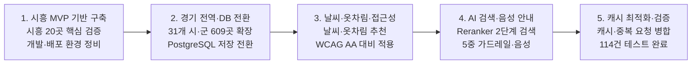
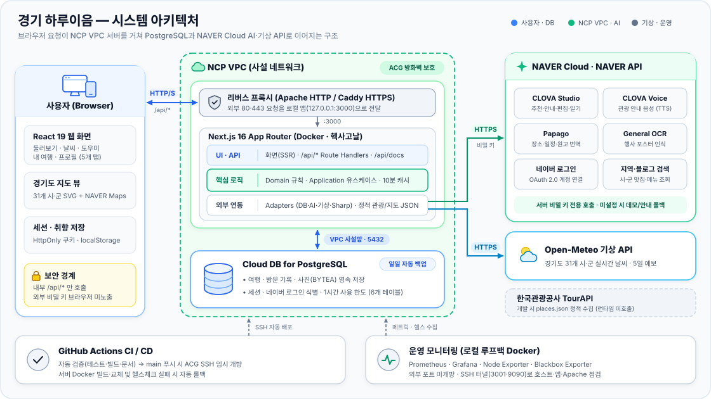
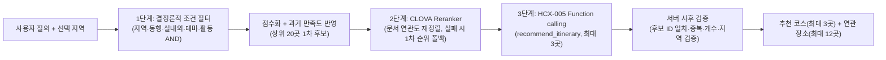
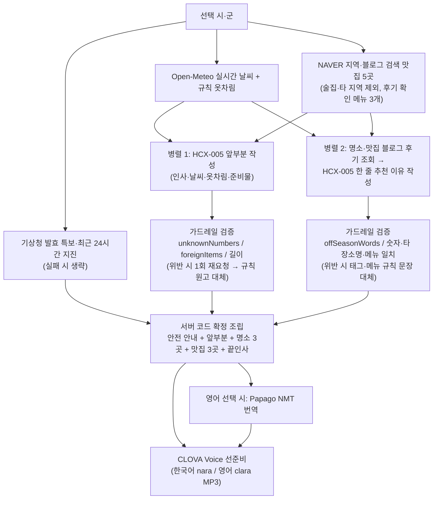
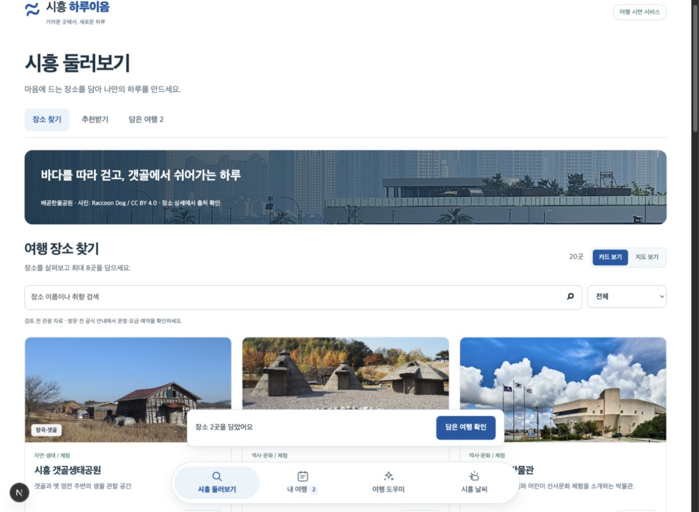
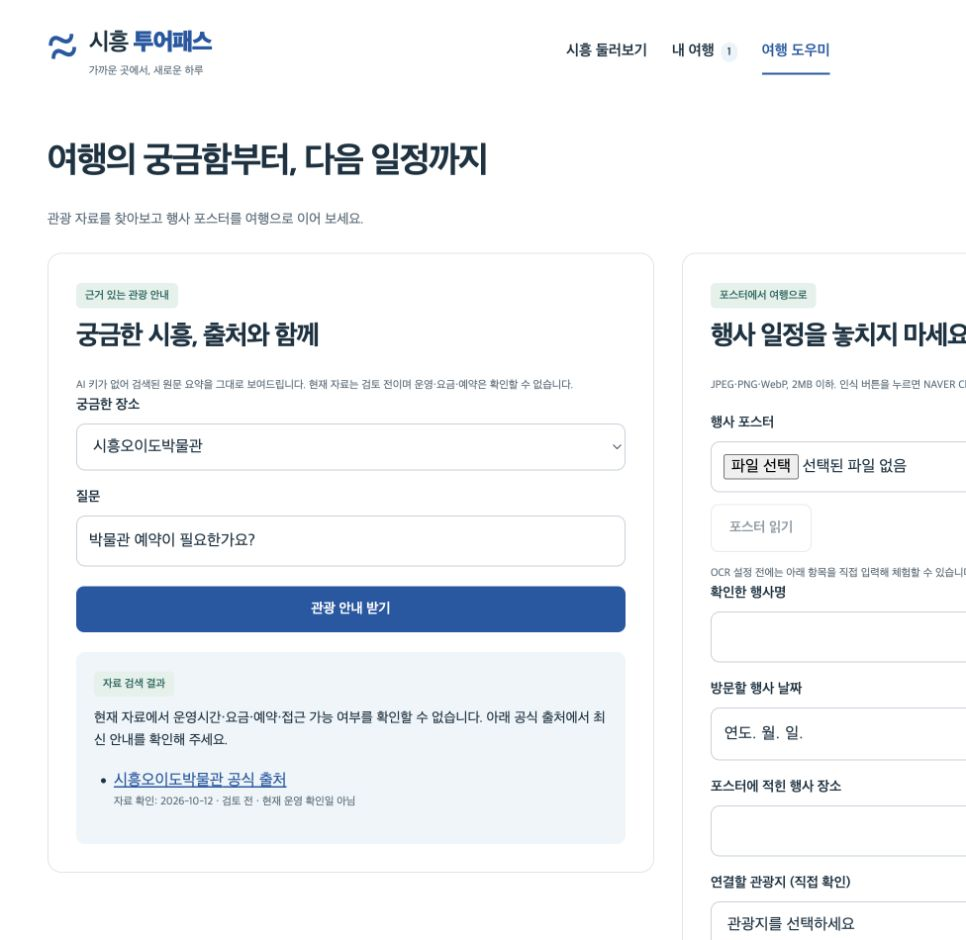
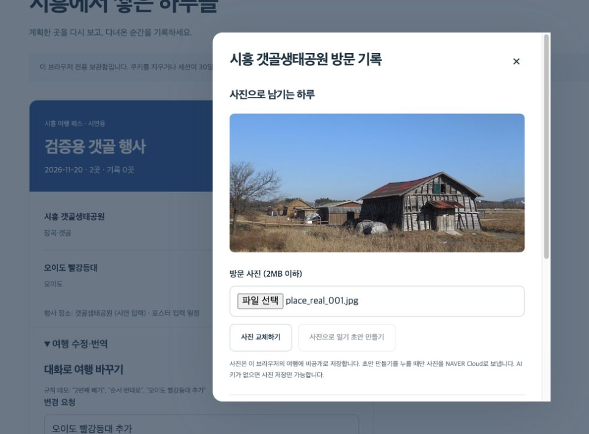

# 제출용 기술 문서 — 경기 하루이음

[문서 안내](../README.md#문서-분류-기준) · [평가 항목 안내](evaluation.md) · [요구사항](01-func/01-requirements.md) · [기술 구조](03-tech/01-architecture.md) · [테스트 명세](04-test/01-verification.md) · [배포 가이드](05-ops/01-deploy.md)

> **문서 정보**
> - **프로젝트명**: 경기 하루이음 (`siheung-tourpass-navercloud`)
> - **문서 기준일**: 2026-11-27 (최신 검증 판정 기준일: 2026-11-21)
> - **문서 성격**: 프로젝트 평가·제출용 단독 기술 보고서(외부 문서 없이 이 문서만으로 기획·설계·구현·검증·운영을 확인할 수 있도록 구성했습니다.)
> - **팀 구성**: 네이버클라우드 6팀 — 김동규(BE) · 김종혁(AI) · 정상겸(OPS) · 주민강(FE) ([1.6 팀 구성 및 역할 분담](#16-팀-구성-및-역할-분담))

---

## 1. 프로젝트 개요 및 기획 배경

### 1.1 추진 배경과 서비스 목표

경기도는 28개 시와 3개 군으로 이루어진 광역 자치단체로 관광 자원이 방대하지만, 방문객이 날씨·안전 특보·동행 유형·근처 맛집·이동 일정을 한 화면에서 종합해 당일 여행을 계획하고 기록하기는 어렵습니다. **경기 하루이음**은 경기도 31개 시·군의 관광지 609곳을 대상으로 탐색, AI 맞춤 추천, 날씨·안전·옷차림·맛집 통합 브리핑, 여행 패스 구성, 방문 기록 및 사진 일기를 하나로 잇는 Next.js 기반 웹 MVP입니다.

### 1.2 구현 범위와 제외 범위

현재 구현 상태, 제외 범위, 향후 확장 목표를 다음과 같이 구분합니다.

| 구분 | 내용 |
| --- | --- |
| **현재 구현** | 경기도 31개 시·군(609곳) 지도·목록 탐색, CLOVA 사전 라벨·Reranker·Function calling 기반 AI 검색·추천, 1~8곳 여행 패스 저장·순서 편집, 방문 만족도(1~5점)·메모·비공개 사진 보관, 통합 안내(기상특보·지진·날씨·옷차림·명소·맛집·한/영 음성), 대화형 여행 편집, 다국어 번역, AI 사진 일기, 포스터 OCR 일정 초안, 네이버 로그인 및 익명 세션 이관 |
| **제외 범위** | 결제·할인·제휴·가맹점·관리자 기능, Object Storage 기반 대용량 미디어 스토리지, 대규모 벡터 DB·임베딩 파이프라인 |
| **확장 목표** | 경기도 범위 유지, 영어 UI(후속 일본어·중국어) 확장, 시·군 단위 추천 연계, HTTPS 도메인 적용 및 다중 인스턴스·Object Storage 전환 |

### 1.3 평가 항목별 근거 매핑

[프로젝트 평가 항목 안내](evaluation.md)의 4개 영역과 본 기술 문서의 대응 절은 다음과 같습니다.

| 평가 영역 (배점) | 핵심 근거 절 |
| --- | --- |
| 1. 기획·주제 적합성 (20점) | [1. 프로젝트 개요 및 기획 배경](#1-프로젝트-개요-및-기획-배경)(발전 과정·팀 역할 포함) · [6. 프런트엔드 UX/UI 및 접근성 설계](#6-프런트엔드-uxui-및-접근성-설계) |
| 2. 핵심 기능·기술 구현도 (35점) | [2. 시스템 아키텍처 및 기술 스택](#2-시스템-아키텍처-및-기술-스택) · [4. 데이터 모델, 동시성 제어 및 HTTP API 계약](#4-데이터-모델-동시성-제어-및-http-api-계약) · [5. 보안 및 개인정보 보호 설계](#5-보안-및-개인정보-보호-설계) · [7. 클라우드 인프라, CI/CD 및 운영 모니터링](#7-클라우드-인프라-cicd-및-운영-모니터링) |
| 3. 데이터·AI 활용도 (25점) | [3. 데이터 파이프라인 및 AI·외부 API 활용 설계](#3-데이터-파이프라인-및-ai외부-api-활용-설계) · [8. 검증 전략, 최신 테스트 결과 및 트러블슈팅](#8-검증-전략-최신-테스트-결과-및-트러블슈팅) |
| 4. 발표 준비도 (20점) | 5개 탭 시연 흐름 요약([1.4 사용자 여정](#14-사용자-여정-5개-탭-구성)), 단계별 발전 과정([1.5](#15-프로젝트-발전-과정-5단계-확장-이력)), 한계·리스크 투명 공개([9. 한계점, 리스크 및 향후 확장 계획](#9-한계점-리스크-및-향후-확장-계획)) — 시연 동영상은 별도 제작 예정 |

### 1.4 사용자 여정 (5개 탭 구성)

애플리케이션은 하단 내비게이션의 5개 탭으로 구성되며, 선택한 시·군 상태(`selectedCityId`)를 탐색·날씨·도우미 탭이 공유합니다.

| 탭 | 핵심 기능과 사용자 흐름 |
| --- | --- |
| **경기 둘러보기** | 상단 AI 자연어 검색·추천과 경기도 31개 시·군 SVG 지도(또는 네이버 지도)로 장소를 탐색하고, 1~8곳을 담아 이름·날짜와 함께 여행 패스로 저장합니다. |
| **경기 날씨** | 경기도 전체(수원 기준) 또는 31개 시·군의 현재 날씨, 규칙 기반 옷차림·준비물, 5일 예보, 날씨 맞춤 추천 장소를 확인합니다. |
| **여행 도우미** | 선택 시·군의 안전 안내(기상청 발효 특보·최근 24시간 지진) → 통합 안내 원고·음성(한국어 `nara`·영어 `clara`) → 옷차림 → 추천 명소 → NAVER 검색 맛집(후기 확인 메뉴 포함)을 한 흐름으로 제공합니다. |
| **내 여행** | 저장한 여행 패스의 코스 지도, 장소별 만족도(1~5점)·방문 메모(500자)·비공개 사진·AI 일기 초안, 대화형 여행 수정(`propose_itinerary`), 다국어 번역(영·일·중)을 이용합니다. |
| **프로필** | 저장 여행 수·방문 고유 장소 수 요약, 브라우저 선호 지역·취향 기본값 저장, 네이버 로그인·로그아웃 및 데이터 보관 정책을 관리합니다. |

> **데이터·시연 고지 정책**: 카탈로그(`data/places.json`)와 사진(`public/places/`)은 검토 전(`DRAFT`) 자료이며 실제 운영시간·요금·예약·최적 동선·혜택을 보장하지 않습니다. 모든 목록·상세 화면에 검토 전 상태, 원문 확인일(`checkedOn`), 공식 출처, 사진 저작자·라이선스·크롭 안내를 함께 표시합니다.

### 1.5 프로젝트 발전 과정 (5단계 확장 이력)

경기 하루이음은 시흥시 단일 지역 MVP로 핵심 흐름을 먼저 검증한 뒤, 5단계에 걸쳐 경기도 31개 시·군 전역과 AI 통합 안내·캐시 최적화까지 점진적으로 확장했습니다.

| 단계 | 핵심 마일스톤 | 주요 구현 및 개선 내용 |
| --- | --- | --- |
| **1. 시흥 MVP 기반 구축** | 시흥 20곳 핵심 검증 · 개발·배포 환경 정비 | 시흥 관광지 20곳을 대상으로 탐색·추천·여행 패스·방문 기록의 핵심 사용자 흐름을 구현하고, 네이버 로그인, Docker/NCP 배포 및 모니터링, 화면 위계와 문서 표준을 정비했습니다. |
| **2. 경기 전역·DB 전환** | 31개 시·군 609곳 확장 · PostgreSQL 저장 전환 | 주제를 경기도 전역으로 확장해 28개 시·3개 군 SVG 경계 지도와 한국관광공사 TourAPI 기반 609곳 카탈로그를 구축했습니다. 코스 지도를 NAVER Maps v3로 전환하고 영속 저장소를 SQLite에서 PostgreSQL(NCP Cloud DB)로 이관했습니다. |
| **3. 날씨·옷차림·접근성 정비** | 날씨·옷차림 추천 · WCAG AA 대비 적용 | Open-Meteo 기반 31개 시·군 실시간 현재 날씨·5일 예보와 규칙 기반 옷차림·준비물 추천을 추가했습니다. 브랜드 그래디언트 테마(`#02823A → #027974`)와 WCAG AA(4.5:1 이상) 대비, 지도 날씨 배지 최소 글자 크기(12px)를 적용했습니다. |
| **4. AI 검색·음성 안내** | Reranker 2단계 검색 · 5중 가드레일·음성 | 609곳 CLOVA 배치 사전 라벨링(수동 보정 41곳 보호 레이어 포함)과 Reranker → `HCX-005` Function calling 2단계 검색·추천을 구현했습니다. 여행 도우미를 지도 기반 오늘의 통합 안내로 개편하고 기상청 안전 안내, NAVER 맛집 검증, 환각 방지 5중 가드레일, Papago·CLOVA Voice(한/영) 음성을 결합했습니다. |
| **5. 캐시 최적화·검증 완료** | 캐시·중복 요청 병합 · 114건 테스트 완료 | 인메모리 TTL·LRU·Singleflight 공용 캐시와 `globalThis` 싱글톤, 350ms 디바운스·`AbortController`, 캐시 히트 시 요청 한도 미차감 로직을 적용했습니다. 헥사고날 아키텍처 경계 검사를 포함한 단위·모의 연동 테스트 114건과 빌드·문서 검사를 완료했습니다. |

### 1.6 팀 구성 및 역할 분담

본 프로젝트는 **네이버클라우드 6팀** 4명이 Backend, AI, DevOps, Frontend 영역을 분담해 협업했습니다.

| 구분 | 담당 영역 | 팀원 | 소속 | 연계 기술 절 |
| --- | --- | --- | --- | --- |
| **BE** | 탐색 · 데이터 (Backend) | 김동규 | 게임공학과 | [3.1 관광 데이터·지도](#31-경기도-31개-시군-관광-데이터-및-지도-구축) · [3.2 사전 라벨링](#32-clova-배치-사전-라벨링과-수동-보정-보호-레이어) · [4. 데이터 모델 및 HTTP API 계약](#4-데이터-모델-동시성-제어-및-http-api-계약) |
| **AI** | AI · 추천·맥락 (AI) | 김종혁 | 기계설계공학부 | [3.3 AI 검색·추천](#33-2단계-ai-검색추천-파이프라인) · [3.4 통합 안내·가드레일](#34-통합-안내briefing-멀티-api-오케스트레이션과-환각-방지-5중-가드레일) · [3.5 도우미 확장](#35-도우미-확장-기능-및-외부-키-미설정-시-폴백-정책) |
| **OPS** | 인프라 · 품질 (DevOps) | 정상겸 | 컴퓨터공학부 | [2.3 헥사고날 아키텍처](#23-헥사고날-아키텍처와-정적-경계-강제) · [5. 보안 설계](#5-보안-및-개인정보-보호-설계) · [7. 클라우드 인프라·CI/CD·모니터링](#7-클라우드-인프라-cicd-및-운영-모니터링) · [8. 검증 전략](#8-검증-전략-최신-테스트-결과-및-트러블슈팅) |
| **FE** | 화면 · 사용자 흐름 (Frontend) | 주민강 | 전자공학부 | [1.4 사용자 여정](#14-사용자-여정-5개-탭-구성) · [6. 프런트엔드 UX/UI 및 접근성 설계](#6-프런트엔드-uxui-및-접근성-설계) |

---

## 2. 시스템 아키텍처 및 기술 스택

### 2.1 전체 시스템 구성

Next.js App Router(Node.js 24)가 UI 렌더링과 내부 Route Handler API(`/api/*`)를 모두 담당하며, 영속 데이터는 외부 PostgreSQL(운영 환경: NAVER Cloud Platform Cloud DB for PostgreSQL, VPC 사설망)에 저장합니다. 브라우저는 서버의 `/api/*` 엔드포인트만 호출하며, 외부 AI·검색·공공데이터·로그인 비밀 키는 서버 런타임 환경 변수에만 보관합니다(브라우저 SDK 로딩에 필요한 `NAVER_MAP_CLIENT_ID`만 예외적으로 런타임 전달).

### 2.2 기술 스택 및 선정 근거

| 계층 | 기술 (버전) | 선정 근거 |
| --- | --- | --- |
| **프레임워크·언어** | Next.js `16.4.6`, React `19.3.1`, TypeScript `7.0.2` | 서버·클라이언트 단일 저장소 구성, Route Handler를 통한 비밀 키 은닉(BFF 패턴), 정적 타입 안정성을 확보합니다. |
| **계약·API 문서** | Zod `4.6.7`, `@scalar/nextjs-api-reference` `0.12.18` | 요청·응답·AI 출력 스키마를 Zod로 단일 정의하고 `z.toJSONSchema`로 OpenAPI 3.1.0 명세(`/api/openapi`)와 Scalar UI(`/api/docs`)를 자동 동기화합니다. |
| **데이터베이스** | PostgreSQL 16+ (CI: 17, 운영: NCP Cloud DB), `pg` `8.23.1` | JSONB 기반 유연한 여행 문서 저장과 `FOR UPDATE` 행 잠금·트랜잭션·원자적 카운터를 ORM 오버헤드 없이 제어합니다. |
| **이미지 처리** | Sharp `0.35.5` | 업로드 이미지의 포맷·픽셀 폭탄·EXIF 회전을 서버에서 안전하게 검증하고 1600px JPEG로 재인코딩해 메타데이터를 제거합니다. |
| **NAVER Cloud·API** | CLOVA Studio(`HCX-005`, `HCX-DASH-002`, Reranker, Vision), CLOVA Voice, Papago NMT, CLOVA OCR, Maps v3, NAVER 검색, 네이버 로그인 | 한국어 관광 도메인 품질과 음성·번역·OCR·지도·인증의 일관된 클라우드 통합을 구현합니다. |
| **외부 공공·기상** | TourAPI 4.0(한국관광공사), 기상청 특보·지진 API(공공데이터포털), Open-Meteo | 경기도 31개 시·군 공신력 있는 관광지·재난·실시간 기상 데이터를 확보합니다. |
| **인프라·관측** | Docker(`node:24-bookworm-slim`), Apache/Caddy, GitHub Actions, Prometheus `v3.16.0`, Grafana `13.3.1`, Node/Blackbox Exporter | 재현 가능한 컨테이너 배포, 자동 롤백, 루프백 전용 경량 모니터링을 구성합니다. |

### 2.3 헥사고날 아키텍처와 정적 경계 강제

외부 API와 DB 교체·단위 테스트 용이성을 높이기 위해 헥사고날(포트-어댑터) 아키텍처를 적용했습니다.

| 경로 | 계층 역할 | 의존성 규칙 |
| --- | --- | --- |
| `lib/domain/` | 카탈로그, Zod 계약, 검색·날씨·옷차림·원고·맛집·특보 순수 규칙 | `zod`와 정적 JSON만 허용하며 프레임워크·DB·네트워크·`Date.now()`·`process.env`에 비의존합니다. |
| `lib/application/` | 유스케이스 오케스트레이션, 포트 인터페이스(`ports.ts`), 공용 캐시(`cache.ts`) | `lib/domain/`과 내부 포트만 참조합니다. |
| `lib/adapters/` | PostgreSQL, NAVER AI/검색/로그인/지도, Open-Meteo, 기상청, Sharp, HTTP, OpenAPI 구현 | 외부 SDK·`fetch`·`pg`·환경 변수 접근을 이 계층으로 격리합니다. |
| `lib/server.ts` | 조립 루트(Composition Root) | 어댑터를 유스케이스에 주입하고 `globalThis.tourpassServer` 싱글톤에 고정해 Next.js 청크·HMR 간 인메모리 캐시를 공유합니다. |
| `app/` · `components/` | 화면과 Route Handler API | DB·외부 어댑터를 직접 호출하지 않고 `lib/server.ts` 조립 객체만 사용합니다. |

이 계층 경계는 문서상의 선언에 그치지 않고, [`tests/architecture.test.ts`](../tests/architecture.test.ts)가 CI마다 전체 `.ts/.tsx` 소스의 `import` 경로와 금지 식별자(`process.env`, `Date.now()`, `fetch()`, `Buffer.`, `pg` 등)를 정규식으로 정적 검사해 위반 시 빌드를 차단합니다.

---

## 3. 데이터 파이프라인 및 AI·외부 API 활용 설계

### 3.1 경기도 31개 시·군 관광 데이터 및 지도 구축

- **경기도 행정구역 SVG 지도**: [`scripts/build_gyeonggi_map.py`](../scripts/build_gyeonggi_map.py)가 SGIS 기반 `vuski/admdongkor(2026-10-01)` 원본의 SHA-256 해시를 검증한 뒤, 서울·인천을 제외하고 일반구를 시 단위로 병합해 28개 시·3개 군 경계 데이터(`data/gyeonggi-map.json`)와 라이선스 파일을 생성합니다.
- **TourAPI 관광지 수집·정제**: [`scripts/import-tourapi.ts`](../scripts/import-tourapi.ts)가 한국관광공사 TourAPI 국문 관광지·문화시설을 수집합니다. 기존 시흥 20곳의 ID를 유지하면서 나머지 30개 시·군의 유효 자료를 시·군별 최대 20곳씩 추가해 **총 609곳(시·군별 16~20곳, 31개 시·군 100% 커버)** 카탈로그를 구축했습니다. 수집 과정에서 법정동 코드·주소 대조, 일반구 병합, 타 시도·좌표 누락·중복 제거, 확인일(`checkedOn`)·콘텐츠 ID·갱신일 보존을 적용하며, 이미지는 저작권 안전성을 위해 **공공누리 제1유형**만 허용합니다.

### 3.2 CLOVA 배치 사전 라벨링과 수동 보정 보호 레이어

초기 휴리스틱은 관광지 이름·설명·기존 태그에서 규칙에 맞는 단어를 찾아 라벨을 붙였습니다. 실내를 나타내는 단어가 발견되지 않으면 기본값인 `야외`를 적용했고, 검색어는 미리 정한 단어 목록에서 골랐습니다. 이 방식에서는 실내 시설이 검색 후보에서 빠지거나 장소별 특징이 검색어에 반영되지 않는 문제가 있었습니다.

이를 개선하기 위해 배치 스크립트가 관광지 이름·기존 태그·설명 등을 CLOVA Studio(`HCX-005`)에 보내고, 응답의 관광지 ID와 라벨 형식을 검증해 카탈로그 609곳에 저장하는 방식으로 전환했습니다. [배치 스크립트](../scripts/label-places.ts)

**사전 라벨링을 선택한 이유**

관광지의 실내외 구분과 테마는 여러 검색에서 재사용할 수 있습니다. 이 분류를 검색할 때마다 CLOVA에 맡기면 사용자가 검색어를 입력하거나 조건을 바꿀 때마다 외부 API 응답을 기다려야 하고 호출 비용도 누적됩니다. 라벨을 미리 저장하면 브라우저가 입력 중에도 외부 AI 호출 없이 미리보기를 갱신할 수 있습니다. 서버 추천에도 같은 필터를 적용해 `시흥 비 오는 날 실내`처럼 지역·날씨·실내 조건을 모두 충족하는 장소로 후보를 제한합니다. 사용자가 AI 추천을 요청하면 서버는 그중 최대 20곳을 CLOVA Reranker에 보내 관련도를 재정렬하고, `HCX-005`로 코스와 추천 이유를 생성합니다. [AI 검색·추천 파이프라인](#33-2단계-ai-검색추천-파이프라인)

| 관광지 | 초기 휴리스틱 라벨 | CLOVA 사전 라벨과 검색에 미친 영향 |
| --- | --- | --- |
| 시흥에코센터 초록배곧 | `야외`, `공원·숲`, `체험·테마` | `실내`, `박물관·전시`, `비오는날`을 부여했습니다. 같은 검색 로직에 초기 라벨과 현재 라벨을 각각 적용해 보니, `시흥 비 오는 날 실내` 검색에서 누락됐던 장소가 후보에 포함됐습니다. |
| 시흥 웨이브파크 | 핵심 검색어가 `체험` 하나였습니다. | 인공 서핑장이라는 설명을 바탕으로 `서핑`, `인공 파도`, `거북섬`을 핵심 검색어로 저장했습니다. |

| 라벨 축 | 허용 값 (Zod 열거형 검증) |
| --- | --- |
| `setting` (실내·야외) | `실내`, `야외`, `실내·야외` (3종) |
| `themes` (테마, 1~4개) | `호수`, `바다`, `산·계곡`, `공원·숲`, `박물관·전시`, `역사·유적`, `체험·테마`, `전망·야경`, `사찰·전통`, `시장·거리`, `예술·공연`, `캠핑·레저` (12종) |
| `companions` (동행, 1~4개) | `아이동반`, `가족`, `연인·데이트`, `혼자·힐링`, `부모님` (5종) |
| `styles` (방식, 1~4개) | `산책`, `비오는날`, `사진명소`, `드라이브`, `교육·학습`, `휴식`, `액티비티` (7종) |
| `keywords` (핵심 검색어) | 최대 6개, 항목당 20자 이내 |

**CLOVA 라벨 후처리**

1. 관광지 609곳의 배치 결과에서 의심 라벨을 찾고, 지역·동행·활동·날씨를 조합한 대표 검색어 20개로 오포함과 누락을 점검했습니다. 해수욕장에 붙은 `호수`, 야외 공원에 붙은 `실내·야외`, 생태공원에 빠진 `공원·숲`·`산책` 등이 보정 대상이었습니다.
2. 41곳의 라벨을 관광지 ID별로 수정해 `source: 'manual'`로 저장하고, 나머지 568곳에는 CLOVA 라벨을 적용했습니다. 구봉솔숲해수욕장은 `호수`를 `바다`·`캠핑·레저`로 보정했습니다. 사전 라벨 배치에서 수동 보정 ID를 제외하고, 라벨 파일을 생성하거나 카탈로그를 읽을 때도 수동 보정값을 우선 적용합니다. [수동 보정 데이터](../data/place-label-overrides.json)
3. 새 배치에서도 같은 오류를 줄이도록 프롬프트에 해안·호수 분류 기준과 인근 실내 시설을 언급한 야외 명소의 분류 기준을 추가했습니다. 검색 순위에서는 `비`가 `박두진 시비`에 걸려 가산점을 받던 한 글자 부분 일치를 제거했습니다. [후처리 변경 기록](https://github.com/navercloud-6/project/pull/21)

| 대표 검색어 | 보정 전 | 보정 후 |
| --- | --- | --- |
| `시흥 자연 산책` | 옥구공원 1곳 | 7곳, 시흥 갯골생태공원 1위 |
| `바다` | 13곳, 구봉솔숲해수욕장 누락 | 30곳, 구봉솔숲해수욕장·제부도해수욕장·대부도 포함 |
| `호수` | 구봉솔숲해수욕장·제부도해수욕장·대부도 혼입 | 세 곳 모두 제외 |
| `비 오는 날 실내` | 상위 5곳 중 `실내` 라벨 3곳, 박두진 시비 3위 | 상위 5곳 모두 `실내` 라벨 |

표는 대표 검색어별 후보 수와 상위 결과를 비교한 것입니다. 회귀 테스트는 주요 관광지의 포함·제외 여부와 재라벨링 시 수동 보정 유지 여부를 확인합니다. [검색 회귀 테스트](../tests/ai-search.test.ts)

### 3.3 2단계 AI 검색·추천 파이프라인

1. **클라이언트-서버 동일 필터링**: `searchPlaces()`가 자연어 질의에서 시·군명을 지역 제약으로 추출하고, 동행·실내외·테마·활동 조건을 모두 충족하는 교집합(AND)으로 필터링합니다. 동의어를 정규화하되 `산책`을 `산`으로 과확장하지 않으며, 조건에 맞는 결과가 없을 때 임의로 범위를 넓히지 않습니다.
2. **만족도 반영 및 Reranker 선별**: 최근 10개 여행의 장소별 만족도(1~5점, 방문 메모 제외)를 `(rating - 3) * 10` 가중치로 합산해 상위 20곳을 추린 뒤, CLOVA Studio Reranker(`/v1/api-tools/reranker`)로 질의와 가장 밀접한 후보를 재정렬합니다. Reranker 일시 오류 시 1차 라벨·키워드 순위로 안전하게 폴백합니다.
3. **Function calling 구조화 생성 및 서버 검증**: `HCX-005` 모델에 `recommend_itinerary` 도구를 강제(`toolChoice`) 호출해 최대 3곳의 코스와 추천 이유를 생성합니다. 서버는 Zod 스키마와 후보 집합 포함 여부를 검증해 카탈로그에 없거나 지역이 어긋난 장소를 원천 차단합니다. 만족도 이력이 없는 일반 질의는 10분·200건 캐시 및 동시 요청 병합을 적용합니다.

### 3.4 통합 안내(Briefing) 멀티 API 오케스트레이션과 환각 방지 5중 가드레일

여행 도우미 탭의 통합 안내는 6개 외부·내부 소스를 결합해 약 1분 분량(한국어 900자, 영어 1,900자 이내)의 원고와 음성을 생성합니다.

LLM의 대표적인 오류(수치 왜곡, 모순된 옷차림 제안, 계절 불일치, 장소명 오기, 재난 정보 누락)를 구조적으로 차단하기 위해 5중 가드레일을 구현했습니다.

1. **책임 분리 조립**: 재난 안전 안내(`withSafety`), 추천 명소·맛집의 고유명사와 확인된 메뉴(`placesTail`), 끝인사(`즐거운 여행 되세요!`)는 AI에 맡기지 않고 서버 코드가 검증된 원본 자료 그대로 결합합니다.
2. **숫자 환각 차단 (`unknownNumbers`)**: AI가 작성한 날씨·옷차림 원고에서 모든 숫자(영하 부호 포함)를 추출해 기온·최저·최고·강수확률·날짜·옷차림 기준 외의 숫자가 하나라도 섞이면 거부합니다.
3. **옷차림 모순 차단 (`foreignItems`)**: 오늘의 규칙 기반 옷차림·준비물 목록에 없는 어휘(예: 한겨울에 `얇은 겉옷` 언급)가 등장하면 거부합니다. 앞부분 검증 실패 시 최대 1회 재요청하고, 재실패 시 결정론적 규칙 원고(`ruleScript`)로 즉시 대체합니다.
4. **계절 불일치 차단 (`seasonOf`, `offSeasonWords`)**: 월(month)보다 실제 기온(최고 5°C 이하 겨울, 최저 20°C 이상 여름)을 우선해 체감 계절을 판정하고, 현재 계절과 어긋나는 후기 표현(예: 겨울의 `벚꽃`·`단풍`·`물놀이`)이 포함된 AI 추천 이유를 걸러냅니다.
5. **후기 기반 메뉴 실존 검증 (`verifiedMenus`)**: NAVER 지역 검색(리뷰 많은 순)에서 술집과 타 시·도·시·군 주소를 제외한 뒤, 블로그 후기에서 CLOVA가 추출한 메뉴 후보 중 실제 후기 본문에 문자열로 존재하는 메뉴만 최대 3개 채택하고, 원본 블로그 요약문은 저장하지 않습니다.

### 3.5 도우미 확장 기능 및 외부 키 미설정 시 폴백 정책

| 기능 | 사용 모델·API | 안전장치 및 검증 규칙 | 키 미설정 시 동작 |
| --- | --- | --- | --- |
| **관광 안내 (`guide`)** | CLOVA Studio (`HCX-005`) | 관련 장소 최대 3곳만 근거로 전달하고 `sourceIds`를 검증합니다. 운영·요금·예약·주차·휠체어 질문은 AI를 호출하지 않고 공식 출처만 안내합니다. | 자료 검색 결과를 직접 표시합니다. |
| **대화형 여행 수정 (`edit` / `apply`)** | CLOVA Function (`HCX-DASH-002`) | `propose_itinerary`로 미리보기 후 사용자 확인 시 `revision`을 대조해 적용합니다(`409` 충돌 차단). 기록·사진 보유 장소 삭제와 포스터 행사 날짜 변경을 차단합니다. | N번째 제외·순서 반전·정확한 장소명 추가 데모를 제공합니다. |
| **장소·여행 번역 (`translate`)** | Papago NMT (`en`, `ja`, `zh-CN`) | 방문 메모를 제외한 장소 설명 또는 여행 이름·날짜·장소 설명만 전송합니다. 정적 장소 번역은 24시간·500건 캐시하고 개인 여행은 미캐시합니다. | 비활성 안내와 HTTP `503`을 반환합니다. |
| **음성 안내 (`voice` / `briefingVoice`)** | CLOVA Voice (`nara`, `clara`) | `spokenKorean()`으로 기호·음수·단위(`°C`, `%`, `m/s`)를 발화 친화 한국어로 정규화합니다. 정적 장소 24시간·100건, 통합 안내 10분 캐시·선준비합니다. | 원고만 표시하고 음성은 비활성·`503`을 반환합니다. |
| **사진 일기 (`diary`)** | CLOVA Vision (`HCX-005`) | 소유자가 직접 요청할 때만 비공개 사진을 전송합니다. 신원·감정·방문 사실 추정을 금지하며 초안은 사용자가 메모 저장을 눌러야 확정됩니다. | 사진 저장만 허용하고 일기 초안은 `503`을 반환합니다. |
| **포스터 인식 (`poster`)** | CLOVA OCR (V2) + CLOVA Studio | `*.apigw.ntruss.com` HTTPS 도메인만 허용하며 원본 포스터 이미지는 저장하지 않습니다. 모호한 날짜는 공란으로 두고 사용자가 장소를 선택해 `event.origin='poster'`로 저장합니다. | 직접 입력·저장만 허용하고 인식은 `503`을 반환합니다. |
| **실시간 날씨·지도** | Open-Meteo, NAVER Maps v3 | 지도 상단 현재 날씨(`/api/weather/current`)는 장애를 예시 기온으로 숨기지 않고 오류·재시도를 표시하며, `WEATHER_MODE=demo` 명시 시에만 시연 표기합니다. Maps 실패 시 경기도 SVG 지도로 폴백합니다. | 날씨 패널은 시연 모드 표시, 지도는 SVG 폴백합니다. |

---

## 4. 데이터 모델, 동시성 제어 및 HTTP API 계약

### 4.1 PostgreSQL 스키마 및 멱등 초기화

[`lib/adapters/postgres.ts`](../lib/adapters/postgres.ts)는 `pg` 연결 풀(`max: 10`, 유휴 30초, 연결 10초)을 사용하며, 첫 DB 요청 시 `pg_advisory_xact_lock(7342019)` 트랜잭션 잠금 안에서 6개 테이블을 멱등 생성해 별도 마이그레이션 절차 없이 다중 요청 경합을 방지합니다.

| 테이블 | 주요 컬럼 | 인덱스·제약 | 용도 |
| --- | --- | --- | --- |
| `sessions` | `token TEXT PK`, `expires BIGINT` | PK(`token`) | 32바이트 세션 쿠키의 SHA-256 해시와 30일 만료 시각 저장 |
| `account_sessions` | `token TEXT PK`, `owner TEXT` | PK(`token`) | 네이버 로그인 세션 해시와 `naver:<sha256(id)>` 계정 식별자 매핑 |
| `oauth_states` | `state TEXT PK`, `session TEXT`, `expires BIGINT` | PK(`state`) | 네이버 OAuth 10분 일회용 `state` 해시와 발급 세션 바인딩 |
| `journeys` | `id TEXT PK`, `owner TEXT`, `data JSONB`, `seq BIGSERIAL` | `journeys_owner_seq(owner, seq DESC)` | 여행 패스·리비전·방문 기록 JSONB 저장 및 최신순 조회 |
| `photos` | `id TEXT PK`, `owner TEXT`, `journey TEXT`, `place TEXT`, `image BYTEA` | `UNIQUE(journey, place)`, `photos_owner_journey(owner, journey)` | 장소별 비공개 방문 사진(1600px JPEG 재인코딩 바이너리) 저장 |
| `limits` | `key TEXT PK`, `count INTEGER` | PK(`key`) | 1시간 단위 버킷(`<기능>:<소유자/global>:<시간>`) 요청 카운터 |

### 4.2 트랜잭션, 낙관적 동시성 제어 및 원자적 한도 관리

- **컨텍스트 전파 트랜잭션**: `AsyncLocalStorage<PoolClient>`로 트랜잭션 클라이언트를 암묵 전파하므로 유스케이스 계층이 `PoolClient`에 의존하지 않고도 원자적 복합 작업을 수행합니다.
- **낙관적 리비전 잠금**: 방문 기록 저장, 여행 수정 적용, 사진 업로드는 트랜잭션 내에서 `SELECT ... FOR UPDATE` 행 잠금으로 현재 여행을 읽고 `revision` UUID를 대조합니다. 동시 수정으로 리비전이 어긋나면 `409 Conflict`를 반환하고, 성공 시 새 UUID 리비전을 발급합니다.
- **원자적 레이트 리미팅과 만료 정리**: `INSERT INTO limits ... ON CONFLICT (key) DO UPDATE SET count = limits.count + 1 RETURNING count` 단일 쿼리로 동시 요청 경쟁 상태 없이 한도를 집계합니다. 시간이 바뀔 때 이전 버킷을 비동기 정리하며, **캐시 히트·진행 중 요청 병합 시에는 한도를 차감하지 않습니다**.

| 요청 영역 | 세션별 (1시간) | 서버 전체 (1시간) | 비고 |
| --- | --- | --- | --- |
| 여행 저장 (`POST /api/journeys`) | 30회 | — | 소유자별 제한 |
| AI 추천 (`POST /api/recommend`) | 10회 | 100회 | 만족도 없는 캐시/병합 히트 시 미차감 |
| 여행 도우미 (`POST /api/assistant`) | 30회 | 150회 | 통합 안내·정적 장소 번역/음성 캐시 히트 시 미차감 |
| 사진 저장 (`POST /api/photos`) | 20회 | 100회 | 한도 초과 시 이미지 디코딩 전 즉시 차단 |
| 포스터 인식 (`POST /api/poster`) | 10회 | 50회 | 한도 초과 시 이미지 처리·OCR 전 즉시 차단 |

### 4.3 인메모리 TTL·LRU·Singleflight 공용 캐시 설계

외부 API 호출 비용과 지연을 줄이고 동시 다발적 요청(thundering herd)을 방지하기 위해 [`lib/application/cache.ts`](../lib/application/cache.ts)에 `createCache<T>`를 구현했습니다. 동일한 키로 동시 요청이 들어오면 진행 중인 `Promise`를 공유(singleflight)하고, 실패 응답과 데모 날씨·개인화 데이터는 캐시하지 않습니다. 용량 초과 시 만료 항목을 우선 정리한 뒤 LRU 순으로 퇴거합니다.

| 캐시 대상 | TTL | 최대 항목 | 공유 범위 및 특이사항 |
| --- | --- | --- | --- |
| 현재 날씨·5일 예보 (`/api/weather`, `/api/weather/current`) | 10분 | 각 64건 | 도시별 공유, 데모 폴백 응답 미캐시 |
| 기상청 특보·지진 (`/api/alerts`) | 10분 | 각 1건(전국) | 전국 자료 1회 조회 후 31개 시·군 서버 필터링 |
| NAVER 맛집·명소 후기 (`/api/restaurants`, `placeReviews`) | 10분 | 64건 / 300건 | 지역·장소별 공유 |
| AI 일반 추천 (`/api/recommend`) | 10분 | 200건 | 과거 만족도 없는 동일 조건 한정 |
| 통합 안내 원고·음성 (`briefing`, `briefingVoice`) | 10분 | 각 64건 | 시·군·언어별 공유, 원고 생성 직후 음성 백그라운드 선준비 |
| 정적 장소 번역·음성 (`translate`, `voice`) | 24시간 | 500건 / 100건 | 개인 여행 번역은 미캐시 |

### 4.4 HTTP API 계약 요약

전체 OpenAPI 3.1.0 명세는 [`lib/adapters/openapi.ts`](../lib/adapters/openapi.ts)가 원본이며 실행 서버의 `/api/openapi`(JSON)와 `/api/docs`(Scalar 대화형 문서)에서 조회할 수 있습니다.

| 메서드 및 경로 | 인증 | 요약 |
| --- | --- | --- |
| `GET` / `POST /api/session` | 공개 / `Origin` | 로그인 설정·인증 상태 조회 / 32바이트 익명 세션 쿠키 발급 |
| `POST /api/auth/naver`, `GET /api/auth/naver/callback`, `POST /api/auth/logout` | `Origin` / `state` | 네이버 OAuth 로그인 시작, 콜백(익명 데이터 계정 이관·세션 교체), 로그아웃 |
| `GET` / `POST` / `PATCH /api/journeys` | 세션 쿠키 | 저장된 여행 조회, 새 여행(1~8곳·포스터 행사 포함) 저장, 장소별 만족도·메모 저장 |
| `POST /api/recommend` | 세션 쿠키 | 자연어·지역·만족도 기반 AI/데모 여행 코스 추천 |
| `POST /api/assistant` | 세션 쿠키 | `action` 분기(`guide`, `edit`, `apply`, `translate`, `voice`, `briefing`, `briefingVoice`, `diary`) |
| `GET` / `POST /api/photos` | 세션 쿠키 | 비공개 방문 사진 조회(`metadata=1` 존재 확인 포함) 및 검증·재인코딩·저장 |
| `POST /api/poster` | 세션 쿠키 | 행사 포스터 OCR 텍스트 추출 및 CLOVA 일정 초안 생성 |
| `GET /api/weather`, `GET /api/weather/current` | 공개 | 시·군별 5일 예보·옷차림·추천 장소 / 지도 상단 현재 날씨 |
| `GET /api/alerts`, `GET /api/restaurants` | 공개 | 기상청 발효 특보·최근 24시간 지진 / NAVER 검색 맛집·후기 검증 메뉴 |
| `GET /api/openapi`, `GET /api/docs` | 공개 | OpenAPI 3.1.0 JSON 및 Scalar 레퍼런스 HTML |

---

## 5. 보안 및 개인정보 보호 설계

### 5.1 인증·세션 및 계정 이관 보안

- **익명 세션 보호**: 32바이트 암호학적 무작위 토큰을 `tourpass-session` 쿠키(`HttpOnly`, `SameSite=Lax`, `Path=/`, 30일, HTTPS 환경 `Secure`)로 발급하고 DB에는 SHA-256 해시만 저장합니다.
- **네이버 OAuth 2.0 방어**: `POST /api/auth/naver`에서 `Origin`을 검증한 뒤 10분 만료 1회용 `state`를 쿠키와 DB(`oauth_states`)에 세션과 묶어 저장합니다. 콜백 시 이중 비교와 `DELETE ... RETURNING` 원자 소비로 재사용·로그인 CSRF를 차단합니다.
- **최소 정보·안전한 이관**: 네이버 프로필·이메일·OAuth 토큰은 저장하지 않고 동일인 식별자의 SHA-256 해시(`naver:<hash>`)만 소유자로 사용합니다. 익명 세션에서 로그인할 때만 기존 여행·사진 소유권을 트랜잭션(`FOR UPDATE OF s`)으로 계정에 이관하고 새 세션 토큰으로 교체합니다(세션 고정 공격 방지, 이미 타 계정에 연결된 세션에서는 이전하지 않음). 로그아웃 시 현재 세션을 폐기하고 빈 익명 보관함을 발급하며 계정 데이터는 유지합니다.

### 5.2 요청·파일·외부 호출 방어

- **CSRF 및 본문 크기 제한**: 상태 변경 요청에 `Origin === APP_ORIGIN` 검사를 강제하고, `readBody()` 스트림 리더로 JSON(기본 8KB)·이미지(2MB) 본문 상한을 메모리 적재 전에 조기 차단합니다. 모든 API 오류·민감 응답은 `Cache-Control: no-store`를 반환합니다.
- **이미지 무결성 및 메타데이터 제거**: [`lib/adapters/images.ts`](../lib/adapters/images.ts)가 `Content-Type`과 실제 매직 바이트 포맷(JPEG·PNG·WebP), 최대 2,000만 화소(`limitInputPixels: 20000000`), 단일 프레임(`animated: false`)을 검사한 뒤 EXIF 회전을 반영해 1600×1600 이하 JPEG(품질 82)로 재인코딩함으로써 EXIF GPS 등 민감 메타데이터와 악성 페이로드를 제거합니다.
- **SSRF·타임아웃·프롬프트 인젝션 방어**: 모든 외부 호출에 `redirect: 'error'`, `cache: 'no-store'`, 타임아웃(NAVER Cloud 30초, 기상청 10초)을 적용하고, OCR URL은 `https://*.apigw.ntruss.com`만 허용합니다. CLOVA 호출 시 `includeAiFilters: true`로 유해 필터 점수를 검증하고, 시스템 프롬프트에 사용자 입력·후기·사진 텍스트를 지시가 아닌 데이터로 취급하도록 명시합니다.

### 5.3 외부 전송 데이터 최소화 정책

| 외부 대상 | 전송 허용 데이터 | 차단·비보관 데이터 |
| --- | --- | --- |
| CLOVA 추천 | 취향 질의, 후보 카탈로그, 최근 10개 여행의 장소별 만족도(1~5점) | 방문 메모, 사진, 개인 식별자 |
| CLOVA 안내·편집 | 질문·편집 요청, 최근 대화 최대 6개, 현재 여행 구조 | 방문 메모, 사진 |
| Papago 번역 | 장소 설명 또는 여행 이름·날짜·장소 설명 | 방문 메모 |
| 통합 안내 (CLOVA·Papago·Voice) | 선택 시·군의 공개 날씨·옷차림·추천 자료와 생성 원고 | 모든 사용자 개인 데이터 |
| NAVER 검색 | 시·군명과 `맛집`·상호·명소 검색어 | 블로그 원문 요약 미보관(메뉴 검증 후 폐기) |
| 공공데이터포털 (기상청) | 특보·지진 조회 기간 및 페이지 번호 | 사용자 위치 미전송(지역 판정은 서버 처리) |
| CLOVA Vision | 소유자가 일기 초안을 명시 요청한 비공개 사진 1장 | 요청 없는 자동 분석 금지 |
| CLOVA OCR·Studio | 사용자가 업로드한 포스터 이미지 | 원본 포스터 이미지 서버 미보관 |

---

## 6. 프런트엔드 UX/UI 및 접근성 설계

### 6.1 시각 체계와 UX 라이팅

- **디자인 토큰과 대비**: [`app/globals.css`](../app/globals.css)에서 토큰을 통합 관리합니다. 외부 웹폰트 없이 한국어 시스템 고딕을 사용해 초기 렌더링 지연을 없애고, 밝은 바탕 위 흰 패널로 정보 위계를 구분합니다. 주요 버튼과 활성 표면은 WCAG AA(4.5:1 이상) 대비를 충족하는 브랜드 그래디언트(`#02823A → #027974`)를 적용합니다.
- **일관된 문체**: 대화형 안내·제목·버튼은 친근한 해요체(`~해요`, `~해 주세요`)를 쓰고, 출처·정책·검토 전 고지는 간결한 안내형(`~합니다`)으로 구분하며 핵심 동작 문구(`여행에 담기` ↔ `담기 취소`, `담은 여행 확인`, `여행 저장`)를 통일했습니다.

### 6.2 상호작용 품질과 접근성

- **지연·경합 제어**: 시·군 전환과 AI 검색에 350ms 디바운스와 `AbortController`를 적용하고, 조건 변경 시 이전 추천과 이전 도시 자료를 즉시 숨겨 늦게 도착한 응답이 화면을 덮어쓰는 현상을 방지합니다.
- **접근성(A11y)**: 건너뛰기 링크, 상단 고정 알림(`role="alert"`, `aria-live`), `dialog` 기반 모달(Esc·바깥 클릭·초점 복귀), 탭 전환 시 본문 초점 이동, 하단 캡슐 내비게이션의 `aria-current="page"`, `prefers-reduced-motion: reduce`를 구현했습니다.

### 6.3 주요 화면 미리보기

| 데스크톱 탐색 (`1365px`) | 모바일 여행 (`390px`) |
| :---: | :---: |
|  |  |

| 데스크톱 여행 도우미 | 사진·AI 일기 기록 |
| :---: | :---: |
|  |  |

---

## 7. 클라우드 인프라, CI/CD 및 운영 모니터링

### 7.1 NCP 서버 및 컨테이너 구성

- **시연 서버 구성**: NAVER Cloud Platform Ubuntu 22.04 서버(`/opt/siheung-tourpass`)에서 앱 컨테이너가 루프백(`127.0.0.1:3000`)으로 바인딩하고, 앞단의 Apache([`deploy/apache-http.conf`](../deploy/apache-http.conf))가 외부 요청을 리버스 프록시합니다. 영속 데이터베이스는 VPC 사설망의 NCP Cloud DB for PostgreSQL을 사용합니다.
- **표준 HTTPS 전환 구성**: 도메인 확보 시 [`deploy/Caddyfile`](../deploy/Caddyfile)로 자동 TLS를 적용하고 `APP_ORIGIN=https://<도메인>`, `COOKIE_SECURE=true`로 전환하며, 서버 ACG는 80/443·관리자 SSH만, DB ACG는 앱 서버 5432 포트만 허용하도록 설계했습니다.
- **컨테이너 보안**: [`Dockerfile`](../Dockerfile)은 `node:24-bookworm-slim` 기반으로 프로덕션 빌드 후 `npm prune --omit=dev`로 개발 의존성을 제거하고 비루트 사용자(`USER node`)로 실행합니다. 비밀 환경 변수 파일(`/etc/siheung-tourpass/app.env`)은 권한 `0600`으로 보호합니다.

### 7.2 GitHub Actions CI/CD 및 자동 롤백

- **CI 파이프라인 ([`.github/workflows/ci.yml`](../.github/workflows/ci.yml))**: `main` 푸시와 모든 PR에서 PostgreSQL 17 서비스 컨테이너를 띄워 `format:check` → `typecheck` → `npm test` → `npm run build` → 프로덕션 서버 기동 후 `tests/http.mjs`·`tests/extensions-http.mjs` HTTP 스모크 테스트를 실행합니다. 문서 변경 시 `.github/workflows/docs.yml`이 `check_docs.py`를 별도 검사합니다.
- **CD 파이프라인 ([`.github/workflows/cd.yml`](../.github/workflows/cd.yml))**:
  1. `verify` 잡이 Python 배포 테스트(`*_test.py`)와 전체 CI 검증을 통과해야 배포 단계로 진입합니다.
  2. `deploy` 잡이 현재 GitHub Runner의 공인 IPv4를 조회해 [`deploy/acg.py`](../deploy/acg.py)로 NCP ACG에 해당 IP(`/32`)의 SSH 접근만 임시 개방합니다.
  3. `git archive`로 소스 아카이브를 SSH 전송해 서버에서 `siheung-tourpass:<git-sha>` 이미지를 빌드하고 [`deploy/deploy-container.sh`](../deploy/deploy-container.sh)로 컨테이너를 교체합니다.
  4. 교체 스크립트는 신규 컨테이너의 `GET /`과 `POST /api/session`(`Origin` 헤더 포함)이 모두 성공하는지 최대 15회 재시도 검증하며, 실패 시 최근 로그를 출력하고 **직전 이미지(`PREV_IMAGE`)로 자동 롤백**합니다.
  5. 배포 성공·실패 여부와 무관하게 `if: always()` 단계에서 임시 SSH ACG 규칙을 최대 3회 재시도로 회수합니다.

### 7.3 운영 모니터링 및 백업

- **루프백 전용 관측 스택**: [`deploy/monitoring/start.sh`](../deploy/monitoring/start.sh)가 Prometheus(`v3.16.0`, 보존 15일/2GB), Grafana(`13.3.1`), Node Exporter(`v1.12.1`), Blackbox Exporter(`v0.29.1`) 4개 컨테이너를 CPU·메모리 상한과 함께 기동합니다. 외부 포트는 일절 열지 않고 `127.0.0.1`에만 바인딩하며 운영자는 SSH 포트 포워딩(`3001`, `9090`)으로만 대시보드에 접근합니다.
- **수집 대상**: 호스트 자원(`127.0.0.1:9100`), 앱 직접 응답(`http://127.0.0.1:3000/`), 프록시 경유 응답(`http://127.0.0.1/`), Prometheus·Blackbox 자체 상태를 15초 주기로 수집합니다.
- **백업**: NCP Cloud DB 일일 자동 백업(7일 보관)을 활성화하고, 필요 시 `pg_dump "$DATABASE_URL"`로 수동 스냅샷을 추출합니다.

---

## 8. 검증 전략, 최신 테스트 결과 및 트러블슈팅

### 8.1 다층 검증 체계

| 검증 계층 | 대상 및 파일 | 주요 확인 내용 |
| --- | --- | --- |
| **아키텍처·정적 검사** | `tests/architecture.test.ts`, `format:check`, `typecheck`, `check_docs.py` | 헥사고날 계층 의존성 위반 차단, TypeScript 타입, Prettier 서식, 문서 링크·앵커·구조 표준 |
| **단위·모의 연동** | `tests/*.test.ts` (18개 파일, 114개 케이스) | 임시 PostgreSQL 스키마에서 세션·CSRF·소유권·리비전 충돌·보호 정책·한도·캐시 병합·만료 정리·AI/날씨/맛집/특보/통합 안내 계약 검증 |
| **프로덕션 HTTP** | `tests/http.mjs`, `extensions-http.mjs`, `auth-http.mjs`, `city-weather-http.mjs` | 프로덕션 빌드 서버 대상 엔드투엔드 API 흐름, 키 미설정 `503`/데모 응답, OAuth 콜백·로그아웃, 31개 시·군 날씨 API |
| **배포 자동화 검사** | `tests/acg_test.py`, `tests/deploy_test.py` (6개 케이스) | NCP ACG 임시 규칙 서명·추가·삭제 로직과 컨테이너 교체·롤백 시나리오 |
| **화면 반응형 검사** | 데스크톱 `1365px` · 모바일 `390px` | 5개 탭·모달·하단 메뉴의 가로 넘침 및 키보드·상호작용 확인 |

### 8.2 최신 검증 판정 (2026-11-21 기준)

현재 확인 완료 항목과 미확인 항목을 명확히 구분해 보고합니다([원본 테스트 명세](04-test/01-verification.md#최신-판정)).

| 항목 | 상태 | 상세 결과 |
| --- | --- | --- |
| **정적·빌드·문서** | 통과 | 로컬 환경에서 `format:check`, `typecheck`, `build`, `check_docs.py` 통과 |
| **단위·모의 연동** | 통과 | 로컬 PostgreSQL 임시 스키마에서 `npm test` **114개 전건 통과** |
| **라벨 데이터 무결성** | 통과 | 609곳(CLOVA 568 + 수동 보정 41)의 스키마·검색 회귀·재라벨링 보정 유지 검사 통과 |
| **프로덕션 HTTP** | 통과 (이전 병합 기준) | AI 키 없는 로컬 서버에서 `http.mjs`, `extensions-http.mjs`, `city-weather-http.mjs` 통과 |
| **실키·실데이터 연동** | 부분 확인 | CLOVA 추천(Reranker·HCX-005), 수원 맛집 5곳, 통합 안내(HCX·`nara`/Papago·`clara`), 수원·시흥·가평 실날씨 확인 |
| **브라우저·배포** | 부분 확인 | 1365px·390px AI 검색·상세창 넘침 없음(이전 병합 기준), 배포 Python 6개·셸 문법·NCP DB 이관·모니터링 확인 |
| **미확인 항목** | 미확인 | 최신 `main` 통합 화면 브라우저 재검증, HTTPS 도메인, Maps·네이버 로그인·OCR·Vision 실키 연동, 반복 질의 품질·지연·과금, 서버 재부팅·DB 복구 훈련, CD PostgreSQL 실실행 |

### 8.3 주요 기술 과제와 해결 사례 (트러블슈팅)

| 문제 상황 | 원인 분석 | 해결 방안 및 효과 |
| --- | --- | --- |
| **1. 자연어 검색의 오매칭과 재라벨링 회귀** | `산책` 검색이 `산` 테마로 과확장되거나, CLOVA 배치 재실행 시 수동으로 바로잡은 대표 명소 라벨이 덮어씌워지는 문제가 있었습니다. | 형태소 부분 일치 대신 명시적 동의어 사전·AND 조건 필터를 도입하고, `data/place-label-overrides.json` 수동 보정 41곳이 재라벨링 시 항상 우선 병합되는 보호 레이어와 회귀 테스트를 추가했습니다. |
| **2. 통합 안내 원고의 수치·계절·장소명 환각** | LLM에 날씨·명소·맛집·후기를 통째로 맡기면 영하/영상 기온 오기, 겨울철 꽃·단풍 후기 인용, 상호명 오타가 발생할 위험이 있었습니다. | 안전 안내·명소·맛집 이름·검증된 메뉴는 서버 코드가 직접 결합하고, AI 생성부에는 `unknownNumbers`, `foreignItems`, `offSeasonWords` 3중 검사 후 1회 재요청·규칙 문장 자동 폴백을 적용해 정확도와 자연스러움을 동시에 확보했습니다. |
| **3. Next.js 서버 청크 분리로 인한 캐시 미공유 및 오류 판별 누락** | App Router 환경에서 Route Handler 번들 청크 간 모듈 인스턴스가 분리되면 인메모리 캐시가 공유되지 않거나 `instanceof ZodError` 판별이 실패할 수 있었습니다. | `lib/server.ts` 컨테이너와 `pg` 풀을 `globalThis` 싱글톤에 고정해 모든 청크가 단일 TTL·LRU·Singleflight 캐시를 공유하게 하고, `isZodError()` 덕 타이핑 보완과 캐시 히트 시 한도 미차감 로직으로 외부 API 호출 비용을 절감했습니다. |
| **4. 동시 여행 편집·기록 저장 시 데이터 유실 위험** | 사용자가 AI 편집 미리보기를 띄운 상태에서 방문 기록이나 사진을 저장한 뒤 이전 편집안을 적용하면 기록이 덮어쓰이거나 기록이 있는 장소가 삭제될 수 있었습니다. | `AsyncLocalStorage` 트랜잭션 내 `SELECT ... FOR UPDATE` 잠금과 UUID `revision` 검증(`409 Conflict`), 기록·사진 보유 장소 삭제 및 포스터 행사 날짜 변경 차단 규칙을 도메인(`assertEditable`)에 강제했습니다. |

---

## 9. 한계점, 리스크 및 향후 확장 계획

### 9.1 현재 리스크와 미확정 항목

| 항목 | 현재 상태 및 대기 이유 | 재개 조건 및 해소 계획 |
| --- | --- | --- |
| **NAVER 실키 전면 검증** | 추천·Reranker·통합 안내(Voice·Papago·맛집)만 기본 질의로 확인했습니다. | Maps·네이버 로그인·OCR·Vision 실키를 연결하고 반복 요청 품질·응답 지연·과금을 계측합니다. |
| **HTTPS 적용** | 전용 도메인 없이 시연 서버 HTTP 환경만 확인했습니다. | 도메인 확보 후 [`deploy/Caddyfile`](../deploy/Caddyfile)로 TLS를 적용하고 `COOKIE_SECURE=true` 및 네이버 로그인 검수를 진행합니다. |
| **관광 데이터·사진 정식화** | `DRAFT` 스냅샷 상태이며 운영 정보 실시간 동기화가 없습니다. | 외부 공개 전 시·군 공식 운영 정보와 사진 라이선스를 재검토하고 주기적 배치 갱신을 도입합니다. |
| **수평 확장 및 스토리지** | 단일 앱 컨테이너의 인메모리 캐시와 PostgreSQL `BYTEA` 사진 저장 구조입니다. | 상용 전환 시 사진은 NCP Object Storage로 이전하고, 인메모리 캐시는 Redis 등 공유 캐시로 교체하며 계정 탈퇴·데이터 삭제 기능을 추가합니다. |
| **발표·시연 동영상** | 발표 슬라이드 구성과 팀 역할 분담은 확정했으나 시연 동영상과 실키 시연 범위가 미확정입니다. | 시연 시나리오와 실키 검증 범위 확정 후 시연 동영상을 제작합니다. |

### 9.2 향후 확장 로드맵

1. **운영 안정화 단계**: HTTPS 도메인 연결, 미확인 실키(Maps·로그인·OCR·Vision) 통합 검증, 최신 `main` 기준 5개 탭 브라우저·CD 실배포 점검을 완료합니다.
2. **서비스 고도화 단계**: 다국어 UI(영어 우선, 일본어·중국어 후속) 확장, 시·군별 실시간 행사·운영 정보 연동, Prometheus Alertmanager 기반 장애 알림을 도입합니다.
3. **상용 확장 단계**: NCP Object Storage·분산 캐시·다중 인스턴스 오토스케일링 및 계정 삭제/개인정보 관리 기능을 구축합니다.
